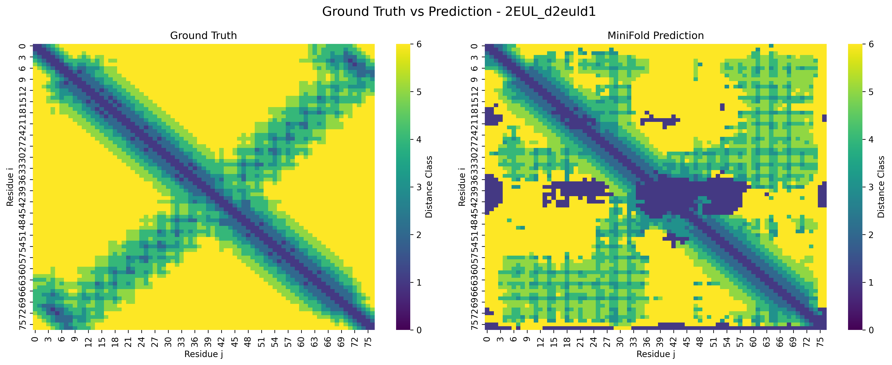
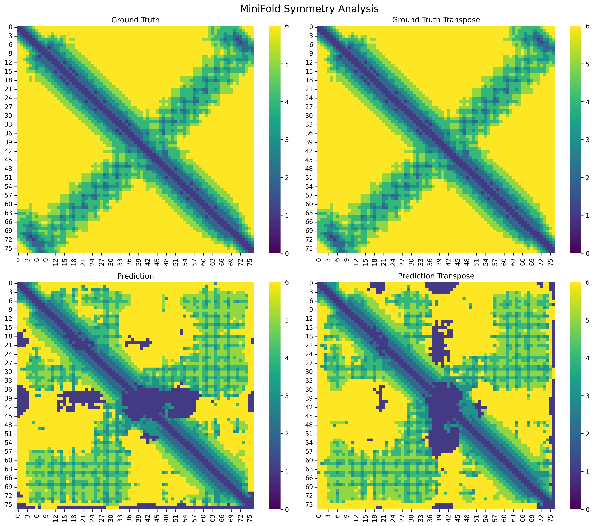
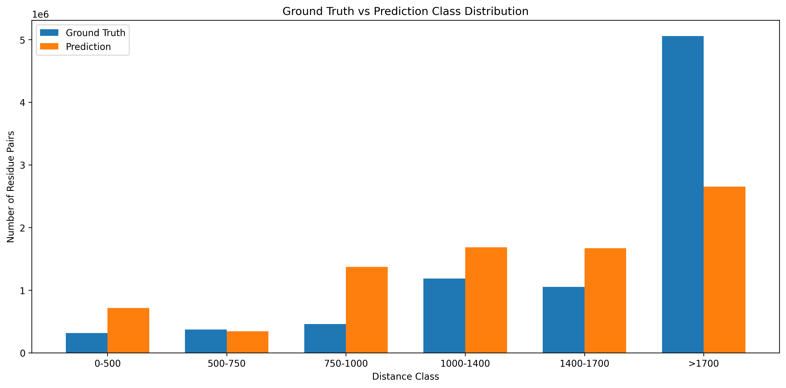
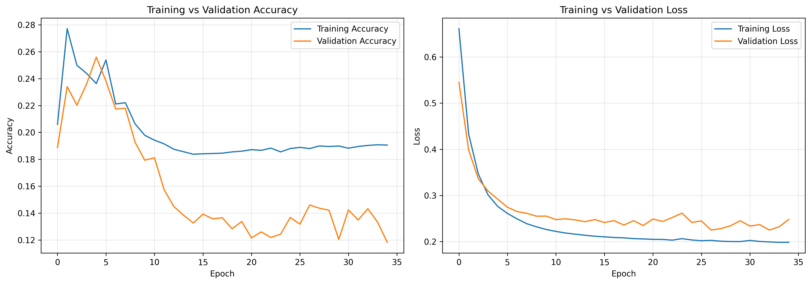
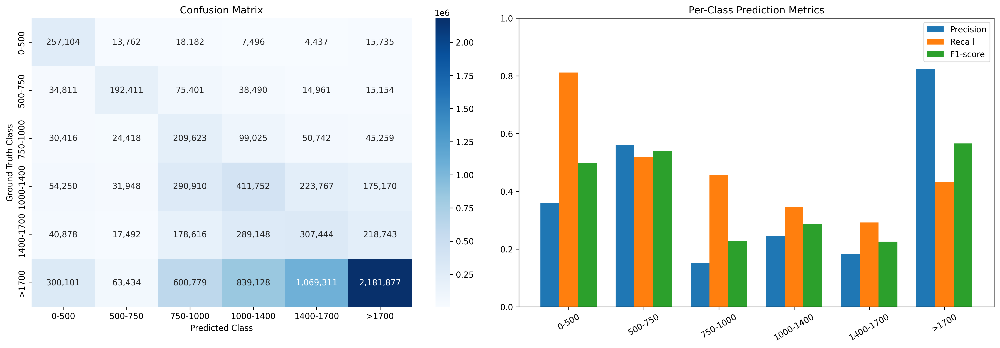

MiniFold：基於 ResNet 的蛋白質距離預測模型

1. 專案介紹（Project Overview）

本專案參考 MiniFold 原始專案，使用 TensorFlow / Keras 建立並訓練一個基於 ResNet V2 的蛋白質距離預測模型。

專案主要目標是利用蛋白質胺基酸序列（Amino Acid Sequence）及位置特異性評分矩陣（Position-Specific Scoring Matrix, PSSM），預測蛋白質中不同胺基酸殘基（Residue）之間的距離分類。

透過 Feature Engineering 將蛋白質序列轉換成二維特徵矩陣，再利用深度學習模型學習殘基之間的距離關係。

```text
本專案主要包含：

蛋白質資料集讀取與前處理
胺基酸序列特徵工程
PSSM 特徵擷取
Ground Truth Distance Matrix 製作
ResNet V2 模型建立與訓練
Training / Validation Accuracy 與 Loss 分析
蛋白質距離預測
Ground Truth 與 Prediction 比較
預測矩陣對稱性分析
分類效能評估與視覺化
專案參考來源
原始 MiniFold Repository：https://github.com/hypnopump/MiniFold
訓練環境：Kaggle Notebook
模型權重：best.weights.h5

```

2. 資料集介紹（Dataset Preparation）
資料來源

本專案使用以下資料集：

python
DATA_PATH = "/kaggle/input/datasets/timjas/full-under-200-txt/full_under_200.txt"


資料內容包含蛋白質名稱、胺基酸序列、PSSM 及距離矩陣。

本次實驗選擇長度小於或等於 200 個胺基酸殘基的蛋白質作為訓練資料。
```text
資料集統計
資料類型	數量
Protein Names	636
Sequences	636
PSSMs	636
Distance Matrices	636
Total Proteins	636

資料集成功載入，共取得 636 筆蛋白質資料。

每筆資料包含：

Protein ID：蛋白質識別名稱
Sequence：胺基酸序列
PSSM：位置特異性評分矩陣
Distance Matrix：蛋白質殘基之間的 Ground Truth 距離矩陣
```

3. 特徵工程（Feature Engineering）

為了讓 ResNet 能夠處理蛋白質序列資訊，本專案將每筆蛋白質資料轉換為固定大小的二維特徵矩陣。

所有輸入資料統一處理為 200 × 200。

主要分為三個部分：

3.1 胺基酸特徵轉換（Amino Acid Encoding）

使用 wider() 函式，將胺基酸序列轉換為兩兩殘基之間的 One-Hot 特徵表示。
```text
python
def wider(seq, l=200, n=20):

    key = "HRKDENQSYTCPAVLIGFWM"
    tensor = []

    for i in range(l):
        d2 = []

        for j in range(l):

            d1 = [
                1 if (
                    j < len(seq) and
                    i < len(seq) and
                    key[x] == seq[i] and
                    key[x] == seq[j]
                ) else 0
                for x in range(n)
            ]

            d2.append(d1)

        tensor.append(d2)

    return np.array(tensor, dtype=np.float32)
```

此函式將每一組殘基配對轉換為 20 個特徵 Channel。

3.2 PSSM 特徵轉換（PSSM Feature Extraction）

使用 wider_pssm() 函式，將 PSSM 轉換為二維特徵矩陣。

特徵包含：

20 個胺基酸 PSSM 配對平均值
1 個 PSSM 配對乘積特徵
1 個殘基位置關係特徵

總共產生 22 個 Feature Channels。
```text
python
def wider_pssm(pssm, seq, l=200, n=20):

    key_alpha = "ACDEFGHIKLMNPQRSTVWY"
    tensor = []

    for i in range(l):
        d2 = []

        for j in range(l):

            if j < len(seq) and i < len(seq):

                d1 = [
                    (aa[i] + aa[j]) / 2
                    for aa in pssm
                ]

                d1.append(
                    pssm[key_alpha.index(seq[i])][i] *
                    pssm[key_alpha.index(seq[j])][j]
                )

            else:
                d1 = [0 for _ in range(n+1)]

            d1.append(1 - abs(i-j)/200)

            d2.append(d1)

        tensor.append(d2)

    return np.array(tensor, dtype=np.float32)
```

3.3 距離矩陣轉換（Distance Matrix Processing）

使用 prepare_distance() 函式，將原始距離矩陣轉換成分類標籤。

所有距離矩陣統一填補至 200 × 200。

距離分類如下：
```text
Class	Distance Range
0	Padding / Invalid
1	0–500
2	500–750
3	750–1000
4	1000–1400
5	1400–1700
6	Greater than 1700
```
透過 One-Hot Encoding 將距離矩陣轉換成 7 個 Channel。

3.4 最終模型輸入格式
```text
特徵	Shape	Channels
Amino Acid Features	200 × 200	20
PSSM Features	200 × 200	22
Model Input	200 × 200	42
Model Output	200 × 200	7

最終輸入及輸出格式：

python
X.shape = (200, 200, 42)
Y.shape = (200, 200, 7)
```

每筆蛋白質資料都會經過相同的特徵工程流程。

4. 模型架構（Model Architecture）

本專案使用原始 MiniFold 專案中的 ResNet V2 架構。

模型程式碼位置：
```text
text
MiniFold/
└── models/
    └── distance_pipeline/
        └── elu_resnet_2d_distances.py
```

模型建立方式：
```text
python
model = resnet_v2(
    input_shape=(200, 200, 42),
    depth=28,
    num_classes=7
)
```
模型參數
```text
參數	設定
Model Architecture	ResNet V2
Network Depth	28
Input Shape	200 × 200 × 42
Output Shape	200 × 200 × 7
Number of Classes	7
Optimizer	Adam
Learning Rate	0.001
AMSGrad	True
Loss Function	Weighted Categorical Crossentropy
加權分類損失函數（Weighted Categorical Crossentropy）
```
由於不同距離分類的資料數量存在明顯差異，因此使用加權 Categorical Crossentropy，調整不同類別對模型訓練的影響。
```text
python
weights = np.array([
    1e-07,
    0.45,
    1.65,
    1.75,
    0.73,
    0.77,
    0.145
], dtype=np.float32)
```

透過不同的權重，讓模型在訓練時能夠考慮各個距離分類的差異。

5. 模型訓練（Model Training）

5.1 訓練集與驗證集切分

本次實驗共有 636 筆蛋白質資料，使用 train_test_split 將資料分成訓練集與驗證集。
```text
python
train_idx, val_idx = train_test_split(
    np.arange(636),
    test_size=64,
    random_state=42,
    shuffle=True
)
```
```text
資料集	蛋白質數量
Training Set	572
Validation Set	64
Total	636
5.2 訓練參數
訓練項目	設定
Epochs	35
Batch Size	2
Optimizer	Adam
Learning Rate	0.001
AMSGrad	Enabled
Framework	TensorFlow / Keras
Data Pipeline	tf.data.Dataset
GPU Strategy	Multi-GPU Strategy
```

使用 TensorFlow tf.data.Dataset 建立資料載入流程，並透過 Batch 與 Prefetch 提升資料處理效率。
```text
python
train_dataset = train_dataset.batch(2).prefetch(1)
val_dataset = val_dataset.batch(2).prefetch(1)
```
5.3 模型訓練程式
```text
python
history = model.fit(
    train_dataset,
    validation_data=val_dataset,
    epochs=35,
    steps_per_epoch=STEPS_PER_EPOCH,
    validation_steps=VALIDATION_STEPS,
    callbacks=callbacks,
    verbose=1
)
```
5.4 Keras 3 相容性調整

由於原始 MiniFold 使用較舊版本的 Keras Import 寫法，因此調整部分程式碼以支援新版 Keras。

修改前：
```text
python
from keras.layers.convolutional import Conv2D, Conv2DTranspose
from keras.layers.pooling import MaxPooling2D, AveragePooling2D
```

修改後：
```text
python
from keras.layers import Conv2D, Conv2DTranspose
from keras.layers import MaxPooling2D, AveragePooling2D
```

此修改主要用於解決新版 Keras 的模組匯入相容性問題。

6. 訓練結果視覺化（Training Visualization）

本專案使用 Training History 繪製訓練過程中的 Accuracy 與 Loss 變化。

6.1 Training vs Validation Accuracy

檔案名稱：
```text
training_accuracy.png @@
```
比較訓練集與驗證集在不同 Epoch 的 Accuracy 變化。

主要觀察：

模型是否逐漸學習特徵
訓練與驗證表現是否存在差距
是否有 Overfitting 現象
模型學習是否穩定

6.2 Training vs Validation Loss

檔案名稱：
```text
training_loss.png@@
```
比較 Training Loss 與 Validation Loss 的變化。

主要觀察：

模型是否逐漸收斂
Loss 是否持續下降
訓練過程是否穩定
是否存在過度擬合現象

7. 訓練模型權重（Trained Model Weights）

訓練完成後，模型權重儲存為：

text
best.weights.h5


模型權重位置：
```text
python
/kaggle/input/datasets/timjas/model-minifold/best.weights.h5
```

訓練紀錄：
```text
python
/kaggle/input/datasets/timjas/model-minifold/training_log.csv
```
載入已訓練模型

後續進行蛋白質預測時，不需要重新訓練模型，只需要建立相同的模型架構並載入權重。
```text
python
model = resnet_v2(
    input_shape=(200, 200, 42),
    depth=28,
    num_classes=7
)

model.load_weights(WEIGHT_PATH)
```

如此即可使用先前訓練完成的模型進行預測與評估。

8. 模型評估（Model Evaluation）

本次使用全部 636 筆蛋白質資料進行預測與評估。

總共處理：

8,442,750 組 Residue Pairs
```text
8.1 整體評估結果
評估指標	結果
Overall Accuracy	42.17%
Macro Precision	38.70%
Macro Recall	47.61%
Macro F1-score	39.05%
Prediction Symmetry	60.00%
Total Proteins	636
Total Residue Pairs	8,442,750
```

整體分類準確率：
```text

Overall Accuracy: 0.42168854934707295

```
模型整體 Accuracy 約為 42.17%。


9. 各距離分類效能分析（Per-Class Evaluation）
```text
以下為六個有效距離分類的 Precision、Recall 與 F1-score。

Distance Class	Precision	Recall	F1-score
0–500	36%	81%	50%
500–750	56%	52%	54%
750–1000	15%	46%	23%
1000–1400	24%	35%	29%
1400–1700	18%	29%	23%
Greater than 1700	82%	43%	57%

```

分類結果觀察


```text
0–500

Recall 達到 81%。
模型能夠辨識大部分此分類的 Residue Pairs。
但 Precision 只有 36%，表示仍存在不少錯誤預測。

500–750

F1-score 為 54%。
是六個距離分類中表現較好的類別。
Precision 與 Recall 相對平衡。

750–1000

Precision 僅有 15%。
是目前模型需要改善的分類之一。
模型容易將其他距離分類錯誤預測為此類別。

1000–1700

兩個分類的 Precision 與 Recall 都不理想。
模型對於中間距離區間的辨識能力仍然不足。

Greater than 1700

Precision 達到 82%，是所有分類中最高的類別。
但 Recall 只有 43%。
模型明顯低估此距離分類的數量。
```

10. 距離分類分布分析（Class Distribution）

比較 Ground Truth 與 Prediction 在不同距離分類中的數量。
```text
Distance Class	Ground Truth	Prediction
0–500	316,718	717,560
500–750	371,234	343,465
750–1000	459,500	1,373,511
1000–1400	1,187,842	1,685,039
1400–1700	1,052,378	1,670,662
Greater than 1700	5,055,078	2,651,938

```

分析結果
```text
從 Ground Truth 與 Prediction 的數量比較，可以觀察到：
0–500 的預測數量高於實際數量。
750–1000 的預測數量明顯偏高。
1000–1400 與 1400–1700 也存在過度預測現象。
Greater than 1700 的預測數量明顯低於 Ground Truth。

其中 Greater than 1700 的差距最大。

Ground Truth 有 5,055,078 組 Residue Pairs，但 Prediction 只有 2,651,938 組。
```
這顯示模型對於較大距離的分類存在明顯低估問題。

11. 預測矩陣對稱性分析（Symmetry Analysis）

本次評估中，最值得注意的問題是模型預測矩陣的對稱性不足。

11.1 對稱性評估結果
```text
Matrix	Symmetry
Ground Truth	100%
Prediction	60.00%
```

對於蛋白質距離矩陣而言，任意兩個胺基酸殘基之間的距離應符合：

```text
Dij=Dji
```
也就是說：

Residue i 到 Residue j 的距離
Residue j 到 Residue i 的距離

理論上應該完全相同。

因此 Ground Truth Distance Matrix 應具有 100% 的對稱性。

然而，本次模型的 Prediction Symmetry 只有約 60%。

11.2 問題原因

目前使用的 ResNet 是一般的 2D CNN 架構。

雖然模型可以學習不同 Residue Pairs 之間的特徵關係，但模型本身並沒有強制輸出矩陣必須符合對稱性。

因此可能出現：
```text
𝑃 𝑖 𝑗 ≠ 𝑃 𝑗 𝑖
```
這代表模型對於相同的殘基配對，可能因為矩陣位置不同而產生不同的預測結果。

這不代表模型完全訓練失敗，而是顯示目前模型架構在對稱性方面仍有改善空間。

11.3 未來改善方向

後續可以考慮：
```text
Symmetric Post-processing：在預測完成後，透過轉置矩陣進行對稱化處理。
Symmetry-aware Loss：在 Loss Function 中加入對稱性限制。
Symmetric Feature Engineering：改善輸入特徵的對稱性設計。
Symmetric Architecture：設計能夠直接保證輸出對稱性的模型架構。
Class Balancing：改善不同距離分類之間的資料不平衡問題。
```
對稱性將會是後續模型改善的重要研究方向。

12. 評估結果視覺化（Evaluation Visualization）

本專案產生多張圖表，用於比較 Ground Truth 與模型 Prediction 的差異。

12.1 Ground Truth vs Prediction

說明:
```text
比較實際距離分類矩陣與模型預測矩陣。
```
12.2 Symmetry Comparison


比較：
```text
Ground Truth
Ground Truth Transpose
Prediction
Prediction Transpose
```
用來觀察模型預測矩陣的對稱性。

12.3 Class Distribution

說明:
```text
比較 Ground Truth 與 Prediction 在六個有效距離分類中的數量差異。
```

12.4 Training History

說明:
```text
顯示模型訓練過程中的 Accuracy 與 Loss 變化。
```

12.5 Confusion Matrix & Per-Class Prediction Metrics


說明:
```text
Confusion Matrix呈現各個距離分類之間的預測結果與錯誤分類情況。
per_class_metrics比較各距離分類的 Precision、Recall 與 F1-score。
```

13. 實驗結果總結（Key Findings）

本次成功使用 636 筆蛋白質資料完成 MiniFold-based ResNet 模型的訓練與評估。
```text
主要成果如下：

資料集建立成功：成功載入 636 筆蛋白質名稱、序列、PSSM 與距離矩陣。
特徵工程完成：將蛋白質資料轉換為 200 × 200 × 42 的模型輸入。
模型訓練完成：使用 ResNet V2，Depth 28，進行 35 個 Epoch 的訓練。
模型預測完成：成功對 636 筆蛋白質進行距離分類預測。
整體準確率：Overall Accuracy 達到 42.17%。
分類效能分析：不同距離區間具有不同的 Precision、Recall 與 F1-score。
對稱性問題：Ground Truth Symmetry 為 100%，但 Prediction Symmetry 只有約 60%。
```
其中，預測矩陣的對稱性是目前最需要進一步研究與改善的問題。

15. 未來研究方向（Future Improvements）
```text
針對本次實驗結果，未來可以從以下方向改善：

改善 Distance Class 的資料不平衡問題。
嘗試不同的 Weighted Loss 配置。
在 Loss Function 中加入 Symmetry Constraint。
研究能夠保證輸出對稱性的神經網路架構。
改善 750–1000、1000–1400 及 1400–1700 的分類能力。
比較不同 ResNet Depth 對預測結果的影響。
嘗試不同的 Learning Rate 與 Batch Size。
研究 Prediction Post-processing 對最終結果的影響。
```
透過上述改善，希望能夠提升模型的距離分類準確率，並使預測結果更符合蛋白質距離矩陣的基本特性。

16. 結論（Conclusion）

本專案成功建立一套基於 MiniFold 與 ResNet V2 的蛋白質距離預測流程，涵蓋資料集前處理、特徵工程、模型訓練、預測及評估。

使用 636 筆蛋白質資料進行實驗，最終模型達到：
```text
Evaluation Metric	Result
Overall Accuracy	42.17%
Macro Precision	38.70%
Macro Recall	47.61%
Macro F1-score	39.05%
Prediction Symmetry	60.00%
```
實驗結果顯示，模型已具備一定程度的蛋白質殘基距離分類能力，但在不同距離區間的分類表現及預測矩陣對稱性方面仍有改善空間。

本次研究也找出一般 2D ResNet 架構在蛋白質距離矩陣預測上的一項重要限制，可作為後續模型架構與訓練策略改良的研究基礎。

17. 參考資料（References）
```text
MiniFold Original Repository
TensorFlow 官方文件
Keras 官方文件
NumPy 官方文件
Scikit-learn 官方文件

專案名稱： MiniFold Protein Distance Prediction

模型架構： ResNet V2 (Depth 28)

訓練資料： 636 Proteins

輸入特徵： Amino Acid Sequence + PSSM

輸入維度： 200 × 200 × 42

輸出維度： 200 × 200 × 7

訓練 Epochs： 35

模型權重： best.weights.h5

開發環境： Kaggle Notebook / Python / TensorFlow / Keras
```

